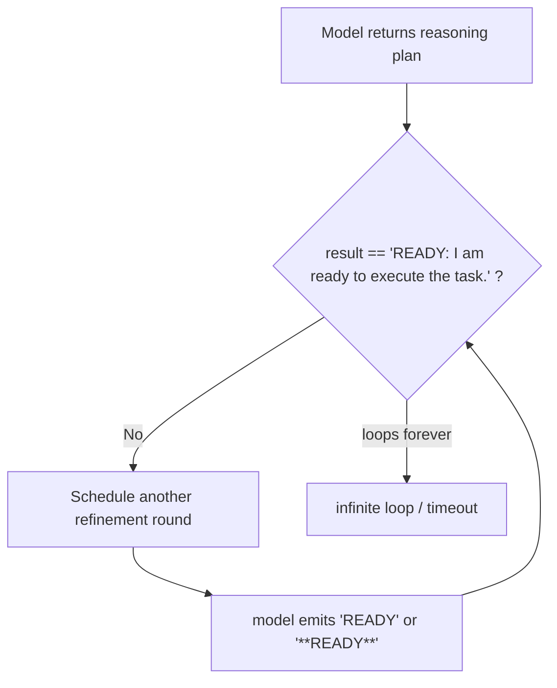
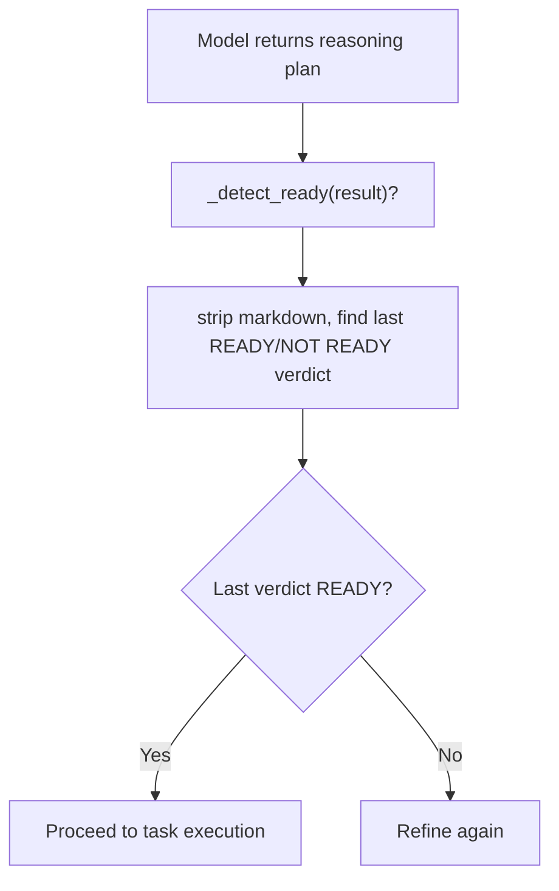

# Fix: Detect bare READY verdicts in reasoning plan to prevent infinite loop

## The Bug

The three planning paths in `reasoning_handler.py` only matched the exact
literal string `"READY: I am ready to execute the task."`. Models that emit a
bare `READY`, lowercase `ready`, or Markdown-emphasised `**READY**` never
triggered the ready condition, causing the refinement loop to run until the
`max_attempts` ceiling was hit — or indefinitely when no ceiling was set.

## The Fix

A new `_detect_ready(text)` helper strips Markdown emphasis markers, then
searches for the last `READY` or `NOT READY` verdict in the response using a
case-insensitive word-boundary regex. Last-verdict-wins semantics ensure that a
trailing `NOT READY` cannot produce a false positive.

All three hardcoded string checks in `_call_with_function` (×2) and
`_parse_planning_response` are replaced with calls to `_detect_ready`.

## PR Description

### Problem

When using local LLM backends such as Ollama or vLLM, the reasoning loop
introduced in recent releases could run until `max_attempts` was exhausted (or
loop forever when no limit was configured). The root cause was that the ready
check required the model to emit the verbatim sentence
`"READY: I am ready to execute the task."`. Models that responded with just
`READY`, `ready`, or Markdown-formatted `**READY**` were never recognised as
ready.

### Solution

Add a `_detect_ready(text: str) -> bool` helper that:

1. Strips Markdown bold/italic emphasis (`**`, `*`, `__`) before matching.
2. Uses `re.search(r'\b(NOT\s+)?READY\b', ...)` case-insensitively.
3. Scans all matches and applies **last-verdict-wins** semantics so that a
   trailing `NOT READY` cannot accidentally return `True`.

The legacy full sentence continues to match as before.

### Testing

Twelve parametrised unit tests cover the legacy sentence, bare/lowercase
verdicts, Markdown variants, negated forms, last-verdict-wins ordering, and
edge cases (empty string, no verdict present).

Fixes #7895
