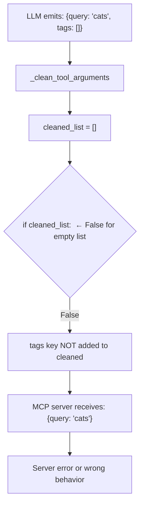
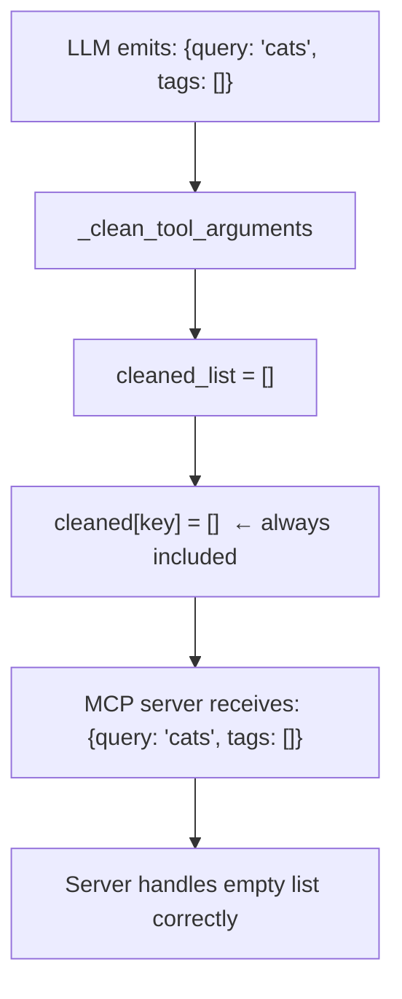

# Fix: MCPClient silently drops empty [] and {} tool arguments

**Issue:** #8045

## The Bug

`MCPClient._clean_tool_arguments` used `if nested_cleaned:` to decide whether to include a dict argument, and `if cleaned_list:` for list arguments. Both conditions evaluate to `False` for empty containers, so `{"tags": []}` and `{"filter": {}}` were silently dropped before reaching the MCP server.

## The Fix

Remove the truthiness guards. Empty `[]` and `{}` are valid, intentional values — only `None` should be skipped (already handled at the top of the loop).

## PR Description

`MCPClient._clean_tool_arguments` silently discarded tool arguments whose value was an empty list `[]` or empty dict `{}`. The `if nested_cleaned:` and `if cleaned_list:` guards evaluated to `False` for empty containers, so the MCP server never received them — breaking tools with optional array/object parameters where the agent intentionally passes an empty value.

Remove the truthiness guards; only `None` values are skipped (handled at the top of the loop). Empty containers are now forwarded as-is.

Fixes #8045
