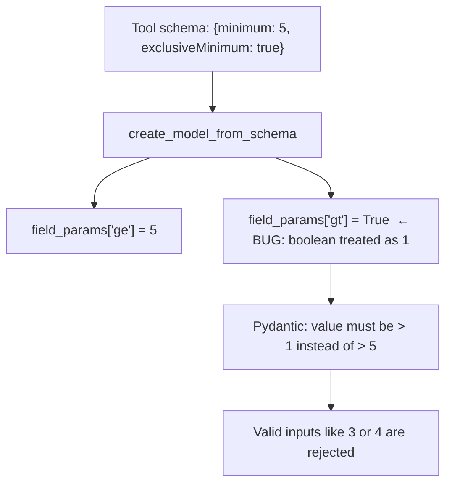
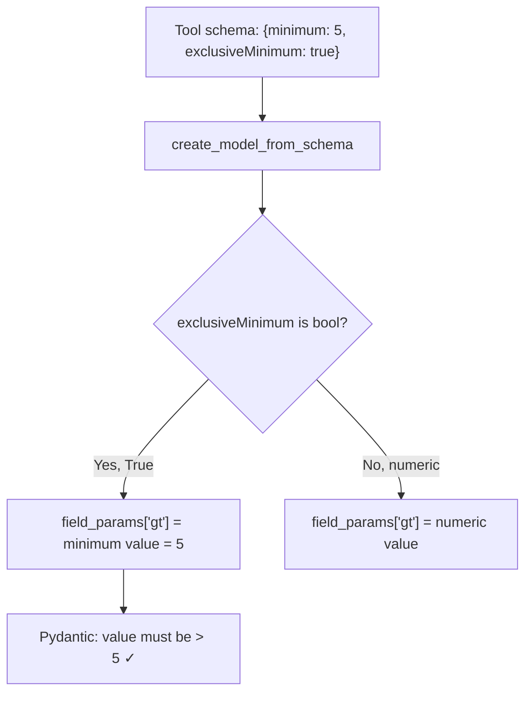

# Fix: Boolean exclusiveMinimum/exclusiveMaximum in JSON Schema tool schemas

**Issue:** #8046

## The Bug

`create_model_from_schema` passed `exclusiveMinimum`/`exclusiveMaximum` directly to Pydantic's `gt`/`lt`. In JSON Schema draft 4 and OpenAPI 3.0, these keywords are **booleans** that modify `minimum`/`maximum` — not numeric bounds themselves. A value of `true` means "the minimum is exclusive". Passing `True` as a numeric bound meant Pydantic used `gt=True` (i.e. `gt=1`), silently rejecting valid arguments.

## The Fix

Check whether `exclusiveMinimum`/`exclusiveMaximum` is a `bool` first. If it is `true`, use the associated `minimum`/`maximum` value as the exclusive bound. If it's numeric (JSON Schema draft 6+), use it directly as before.

## PR Description

Tool schemas using the JSON Schema draft 4 / OpenAPI 3.0 boolean form of `exclusiveMinimum` and `exclusiveMaximum` had their constraints silently broken. The boolean `true` was passed directly to Pydantic's `gt`/`lt`, which interpreted it as the number `1`, rejecting valid inputs and accepting invalid ones.

This fix checks for the boolean form first and, when present, derives the exclusive bound from the paired `minimum`/`maximum` value. Numeric `exclusiveMinimum`/`exclusiveMaximum` (JSON Schema draft 6+) continue to work as before.

Fixes #8046
